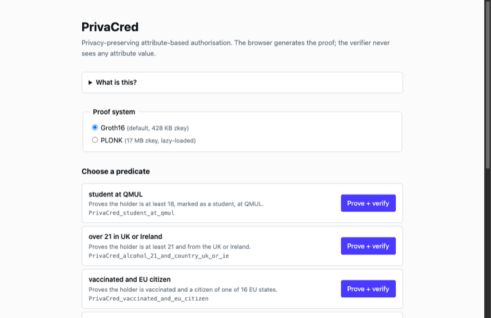
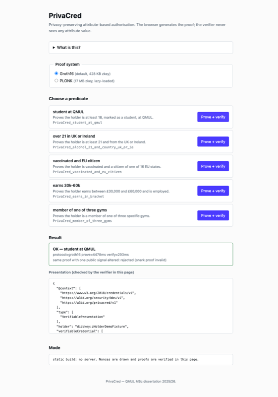
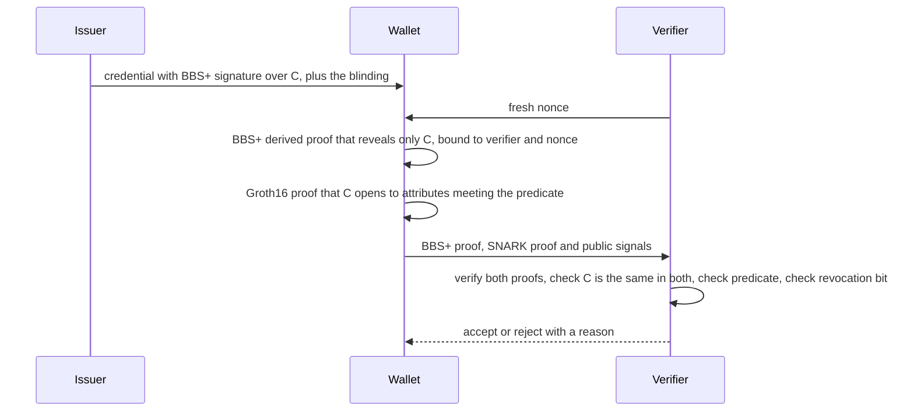
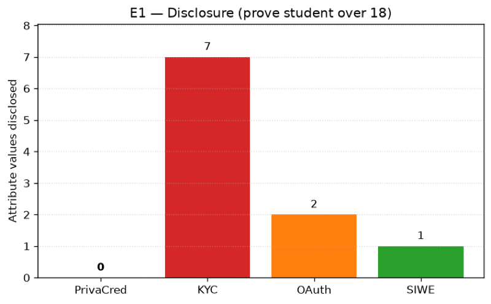
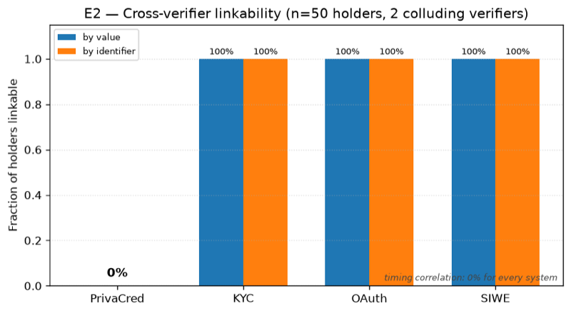
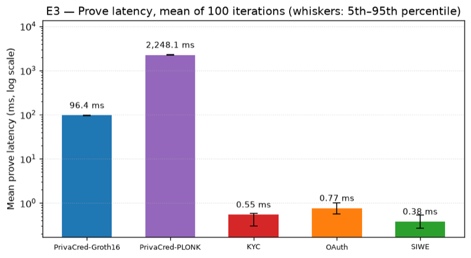
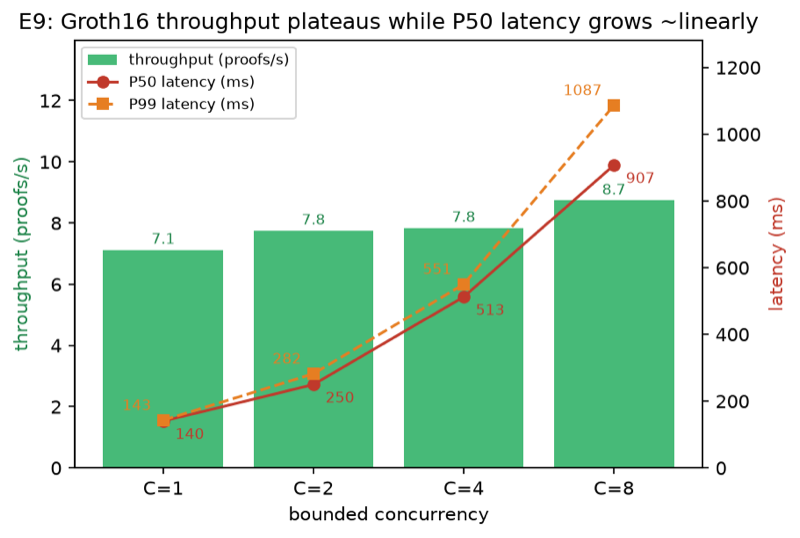

# PrivaCred

**[Live demo](https://dominicdamire.github.io/privacred-demo/)**: generate and verify a Groth16 or PLONK proof in your browser.

> **Public demo repository.** The root of this repository is the built, static browser demo (served by GitHub Pages); README, charts and screenshots are the write-up. **Source code is private; available on request** (zalyatovdamiredominic@gmail.com).

## The problem

Proving "I am a student over 18" normally means handing over the documents or attributes themselves, so the verifier learns (and can store and link) far more than the one fact it needed. PrivaCred explores proving only the predicate.

Privacy-preserving authorisation prototype. A holder proves a predicate about a credential, for example "student at QMUL, age 18 or over", without revealing any attribute value. It combines BBS+ selective-disclosure credentials with Groth16 zk-SNARKs, bound together through Poseidon commitments.

*The browser demo. The proof for "student at QMUL" is generated in the page and accepted by the verifier. The presentation it sends carries only the commitment (`ageCommitment`), no attribute values. A PLONK run is in `screens/`.*

## Screens

Captured from the live demo (headless Chrome). Left: the page on load. Right: after pressing "Prove + verify" on "student at QMUL" (Groth16: prove 4,478 ms, verify 293 ms on this run, and the copy with one public signal altered is rejected).

| | |
|---|---|
|  |  |

## What it does

- **Issuer** signs a credential. The BBS+ signature covers a single Poseidon commitment `C = Poseidon(age, student, institutionHash, blinding)`.
- **Wallet** derives a BBS+ proof that reveals only `C`, plus a Groth16 (or PLONK) proof that `C` opens to attributes satisfying the requested predicate.
- **Verifier** checks the BBS+ proof, the SNARK proof, that both refer to the same `C`, the predicate parameters, a one-time nonce and a locally cached revocation list. It never contacts the issuer and never sees an attribute value.
- **Predicate compiler** turns range, equality and set-membership predicates (AND / OR) into Circom circuits. Nine demo predicates are registered.
- **Unlinkability**: a different pairwise DID per verifier, and commitment pools for a bounded number of unlinkable presentations.
- **Browser demo**: a Vite page where the proof is generated in the browser (Groth16 or PLONK). The [live version](https://dominicdamire.github.io/privacred-demo/) also verifies in the browser; run against the demo server, the proof is checked by the server's verifier.
- **Evaluation harness** (E1 to E9) compares PrivaCred with three mock baselines: centralised KYC, OAuth 2.0 / OIDC and Sign-In With Ethereum.

**Tech:** TypeScript (npm workspaces, strict mode), Circom 2 and snarkjs 0.7.6 (Groth16 and PLONK), Poseidon via circomlibjs, `@digitalbazaar/bbs-signatures`, Express, Jest. Python (numpy, pandas, matplotlib) for the evaluation.

## How it works

BBS+ runs on BLS12-381 and the SNARK on BN254, so the two proofs are verified separately and tied together by value: `C` is the only message the issuer signs and also a public input of the circuit, and the verifier requires the two copies to be equal. 

## Results

Recorded outputs of the evaluation harness (charts below; the CSV and JSON are in the private repository).

*E1: attribute values the verifier holds after one "prove student over 18" exchange. The baseline counts come from the wire formats of the mock KYC, OAuth and SIWE servers in `packages/baselines`.*

*E2: share of 50 simulated holders that two colluding verifiers can link, by disclosed value and by identifier. PrivaCred 0%, KYC / OAuth / SIWE 100%. It is a simulation of each system's wire format, and timing correlation is 0% for every system.*

*E3: mean time to produce the proof artefact over 100 iterations (log scale, whiskers 5th to 95th percentile). PrivaCred builds a full presentation: Groth16 96.4 ms, PLONK 2,248.1 ms. Mean verification is 46.57 ms (Groth16) and 48.70 ms (PLONK) against 0.36 to 0.45 ms for the baselines. Mean payload is 2,661 B (Groth16) and 4,035 B (PLONK).*

*E9: Groth16 prove + verify under bounded concurrency (60 iterations per level, one reused credential, Apple M4). Throughput goes from 7.1 to 8.7 proofs/s as concurrency goes from 1 to 8, while median latency rises from 140 ms to 907 ms.*

| Experiment | Result |
|---|---|
| E4 revocation | 10 credentials issued, 5 revoked, issuer offline: 5 of 5 valid accepted, 5 of 5 revoked rejected |
| E5 replay | 50 runs: first submission accepted 100%, resubmission with the same nonce accepted 0% |
| E6 predicate correctness | 32 combinations of age, student, institution and threshold: the verifier matched the ground truth in 32 of 32 (TP 4, TN 28, FP 0, FN 0) |
| E8 predicate compiler | 9 predicates, 528 to 4,787 R1CS constraints. Mean Groth16 prove 60 to 202 ms and PLONK prove 338 to 2,253 ms (3 runs); proofs about 720 B (Groth16) and 2.1 KB (PLONK) |

## Architecture and stack

Nine npm workspaces (strict TypeScript): `core` (types, Poseidon, BBS+ wrapper, pairwise DIDs), `circuits` (reference circuit, compile and setup scripts), `compiler` (predicate compiler, registry, Merkle sets), `issuer`, `wallet`, `verifier`, `demo-server` (Express), `demo-web` (Vite browser front end) and `baselines` (mock KYC, OAuth / OIDC and SIWE servers). The live demo here is `demo-web` built for GitHub Pages: the circuit files are static, proofs are generated in the page, and verification runs in the page with a port of the verifier's checks (BBS+ proof, SNARK proof, commitment binding, valid bit). Because prover and verifier share a browser, it shows that proofs verify, not an independent verifier; the nonce is drawn in the page and there is no replay protection. The page also verifies a copy of each proof with one public signal altered and shows it is rejected. Credentials are pre-issued with a public test key, so there is no issuance step.

What is in this repository: `index.html`, `assets/` (bundle) and `artefacts/` (verification keys, proving keys and WASM witness generators for the nine demo predicates; the browser needs them to prove), `charts/` (evaluation E1 to E9) and `screens/`.

## Tests

The private repository has 190 tests across 10 workspaces: 189 pass and 1 is skipped (the live Google JWKS check, enabled with `RUN_LIVE_GOOGLE_JWKS=1`). Proofs are generated for real, so a full run takes a few minutes (287 s for install, build, lint and tests on an Apple M4, as recorded in the source README). They cover:

- `core`: Poseidon snapshots, BBS+ wrapper input handling, pairwise DIDs.
- `circuits`: witness and proof generation and verification on the committed artefacts, including the public-signal order.
- `issuer`: issuance, revocation and the HTTP handlers.
- `wallet`: storage, pairwise DIDs, predicate handling, proof generation, the pool unlinkability property and an issue, prove and verify integration test.
- `verifier`: each verification step, revocation and the HTTP handlers.
- `compiler`: circuit code generation, and an end-to-end prove and verify with the compiler-built circuits for the demo fixtures.
- `demo-server` and `baselines/{kyc,oauth,siwe}`: HTTP behaviour.

Counts are from the source repository's README and were not re-run for this page.

## Academic context

MSc Advanced Computer Science dissertation, Queen Mary University of London, 2026. Graded Distinction.

## Status and limits

- Research prototype, not audited for production use.
- The Groth16 keys have a single phase-2 contributor (the author) on top of the public Hermez Powers of Tau, which is adequate for a prototype only.
- The hosted demo verifies in the visitor's browser with a port of the verifier's checks (`local-verify.ts`), not with the server-side verifier, and has no nonce replay protection. The server-backed demo needs the demo server.
- E1 and E2 model the baselines' wire formats; they do not measure real deployments. E9 reuses a single credential.
- Commitment pools give a bounded number of unlinkable presentations, not unlimited ones. The revocation cache fails open when it is stale or empty.
- The demo credentials are signed with a public test keypair (in the source repository), not a real issuer key.

## Licence

MIT. See [LICENSE](LICENSE).

## Author

Damire Zalyatov

## History

Developed in a private repository.

